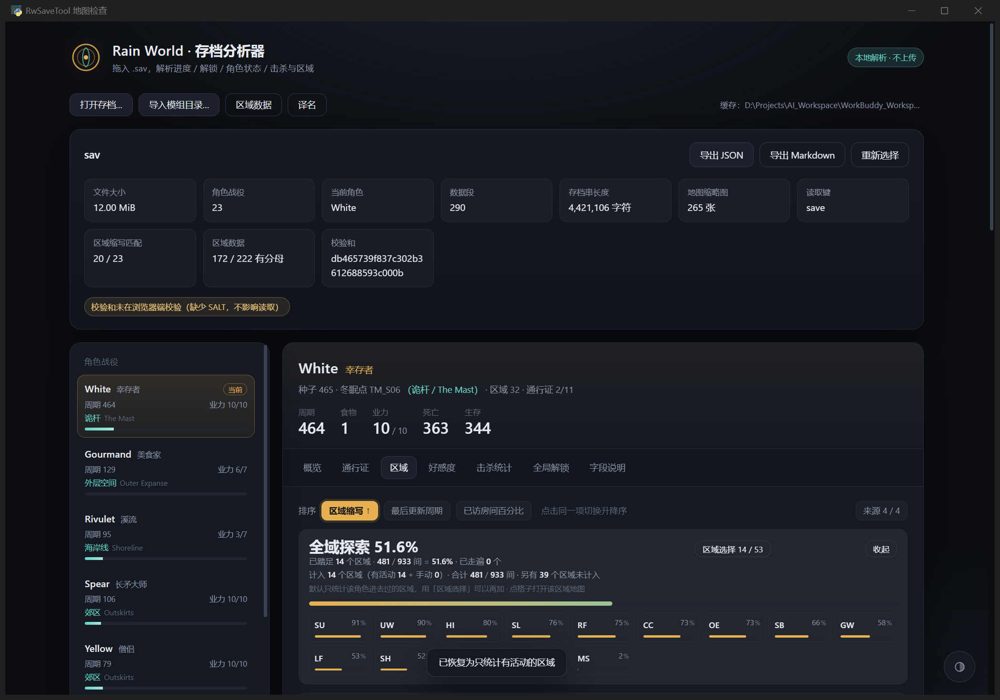
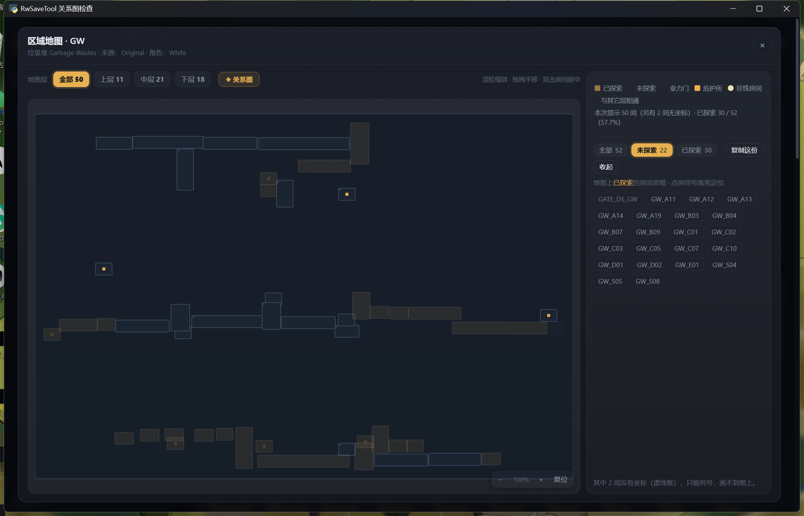
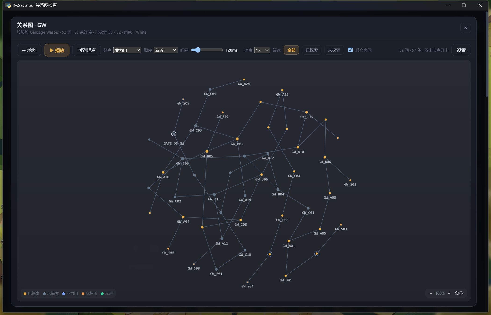

# 雨世界存档分析器 · RwSaveTool

一个 **只读**的 Rain World（雨世界）存档查看工具。独立窗口运行，不需要浏览器，**不会修改你的存档**。

它能告诉你：每个区域还差几间房、没探索的房间在哪、哪些房间之间连着、这个存档杀了多少东西。

**系统**：Windows 10 / 11（64 位）　**版本**：v1.0.0

---

## 下载与运行

到 [Releases](../../releases) 下载最新版 zip（约 26 MB），**解压到任意文件夹**。

里面有两个 exe，**任选一个双击**，功能完全一样：

| 文件 | 适合 | 说明 |
|---|---|---|
| `RwSaveTool.exe` | 日常用 | 启动快，约 0.3 秒。**必须和旁边的 `_internal` 文件夹放一起** |
| `RwSaveTool-onefile.exe` | 想放桌面 / 单独拷给别人 | 就一个文件，随便挪。启动慢 1~3 秒 |

> 不需要安装，不需要 Python，也不需要联网。
> 除非你只用单文件版，否则**别删 `_internal` 文件夹**。

## 第一次使用

1. **选存档** —— 启动后一般会自动找到存档；没找到就点「选择存档」，选
   `C:\Users\你的用户名\AppData\LocalLow\Videocult\Rain World\sav`。
2. **导入游戏数据** —— 这一步必须做。本工具**不附带任何游戏数据**，需要从你电脑上装的正版游戏里读一次：
   点「导入游戏原版数据」，选中游戏的安装目录（Steam 版一般是
   `...\steamapps\common\Rain World`），几秒后就会列出全部区域。
   装了模组的话，再用「导入模组」选创意工坊目录，模组区域也能算完成度。
3. **看数据** —— 区域列表看完成度，点进去看房间地图，右上角还能切「区域拓扑」看房间之间的连接。

导入只需要做一次。以后换电脑、挪动游戏目录，再导一次即可。

## 能从里面看到什么

- **区域完成度** —— 按房间算百分比，可以选「严格」（只算当前角色去得了的）或「宽松」（算全部房间）
- **房间级地图** —— 游戏原版底图上标出哪间去过、哪间没去过
- **区域拓扑** —— 把区域里的房间和门画成一张关系图，能搜索定位
- **世界拓扑** —— 区域与区域之间的业力门关系
- **击杀统计** —— 各种生物杀了多少，配环形图和估算分数
- **自定义译名** —— 官方中文名不喜欢可以改；还能导入 `English|中文` 对照表批量替换

| | |
|---|---|
|  |  |

## 常见问题

**存档会被改坏吗？**
不会。程序以只读方式打开存档，从不写回。你担心的那种「存档被工具污染」不会发生。

**提示找不到游戏目录 / 区域列表是空的？**
先确认游戏是正版且已安装。然后手动点「导入游戏原版数据」，指向
`...\steamapps\common\Rain World`（里面能看到 `RainWorld_Data` 那个文件夹的目录）。

**有区域的完成度显示 `—` 或中文名是「未识别」？**
说明那个区域的数据还没导入（常见于模组区域）。导入对应模组后就会正常显示。

**双击没反应 / 闪退？**
先用目录版。目录版打不开多半是 `_internal` 没解压完整，重新解压一遍。
Windows 10 如果提示缺少 WebView2，装一下微软的「WebView2 Runtime」即可（Win11 自带）。

**杀毒软件报警？**
PyInstaller 打包的程序常被误报。可以把文件加白名单，或者直接用源码跑（见下方开发说明）。

**换了电脑，数据要重新导入吗？**
要。区域数据是从你本机游戏目录读出来的，没有随程序一起分发。

## 关于这个项目

我这里开始只是做着玩的，后来就把自己的各种想法都拿ai去实现，~~（区域拓扑图这是什么神经复杂的玩意）~~，目前的代码能力不强只能用ai来生成工具（还在挣扎学qwq），希望大家喜欢OvO

**开发方式说明（诚实告知）**：本项目由**本人提出需求、测试与验收，代码、界面与文档主要由DeepSeek生成**。
本人是雨世界玩家而不是专业程序员，这个工具最初只是「想知道自己还差几间房」。
因此：AI 生成的代码在边界情况上可能考虑不周，遇到 bug 或算错的地方，欢迎开 Issue 告诉我，比默默卸载有用得多。

**免责声明**：非官方粉丝作品，与 Videocult 无任何关联，未获授权或认可。
*Rain World* 及其游戏素材版权归 Videocult 所有。本仓库**不包含**游戏本体、图像、音频或关卡数据，
只在运行时读取你本机的游戏文件与存档。请支持正版：<https://rainworldgame.com/>

**许可证**：[MIT](LICENSE)。代码可自由使用和修改，但这不覆盖任何第三方游戏素材的权利。

---

想改代码或自己打包？见 [`DEVELOPMENT.md`](DEVELOPMENT.md)（架构、回归清单、发版流程）。
